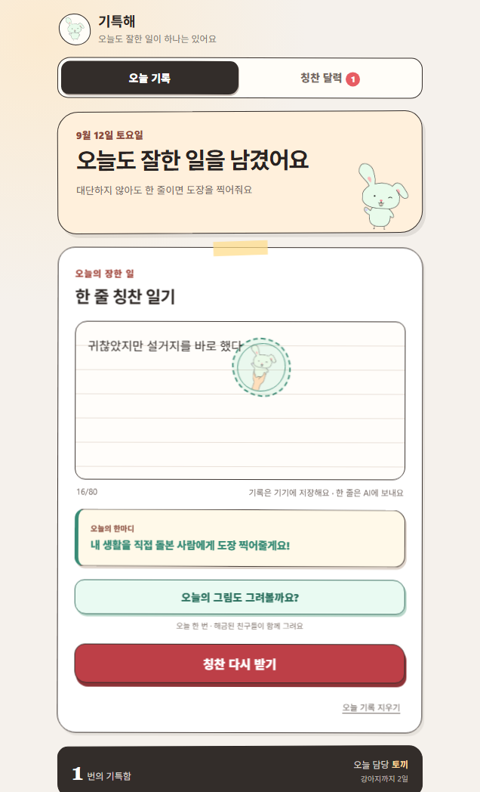

<strong>최윤서 · Yoonseo Choi</strong> 게임의 선택, 하루의 기록, 대화의 흐름을 코드로 구현합니다.

<a href="#게임">게임</a> · <a href="#웹">웹</a> · <a href="#앱">앱</a> · <a href="#학습">학습</a>

| 분야 | 대표 작업 | 살펴볼 부분 |
| --- | --- | --- |
| 게임 | [고백은 세이브 로드가 없다](https://github.com/yoon778/26_WinAPI_No_Save_Love_Project) | Win32 게임 흐름 · 시나리오 · 팀 역할 |
| 웹 | [말사이](https://github.com/yoon778/mal-sai) | AI 대화 상태 · 평가 근거 검증 · 기록 복원 |
| 앱 | [기특해](https://github.com/yoon778/giteukhae) · [AutoMoney](https://github.com/yoon778/AutoMoney) | 토스 미니앱 · Android 알림 처리와 로컬 저장 |

## 게임

### [고백은 세이브 로드가 없다](https://github.com/yoon778/26_WinAPI_No_Save_Love_Project)

**플레이 결과와 인물 선택이 7개 엔딩으로 이어지는 Win32 비주얼노벨**

기존 발표·튜토리얼의 플레이 화면 · <a href="https://github.com/yoon778/26_WinAPI_No_Save_Love_Project/blob/main/docs/CREDITS.md">팀 역할과 화면 출처</a>

`C++20` `Win32 API` `GDI / GDI+`

- **게임 구성** — 다섯 미니게임, 능력치와 누적 선택에 따른 엔딩 분기
- **담당 역할** — 2인 팀의 공동 프로그래밍, 시나리오, 등교길, 유혹피하기
- **살펴볼 코드** — 메시지·입력 분배, 장면 전환, 화면 버퍼 재사용

[플레이 · 구현 · 실행 방법](https://github.com/yoon778/26_WinAPI_No_Save_Love_Project) · [팀 크레딧](https://github.com/yoon778/26_WinAPI_No_Save_Love_Project/blob/main/docs/CREDITS.md)

## 웹

### [말사이](https://github.com/yoon778/mal-sai)

**상황을 읽고, 직접 답하고, 실제 대화를 돌아보는 AI 대화 연습 프로토타입**

AI 호출 없이 실행한 로컬 체험 화면 · 체험 모드에서는 AI 점수를 제공하지 않음

`JavaScript` `Node.js` `SQLite` `OpenAI API`

가상 시간과 대화 상태를 연결하고, 평가가 사용자가 실제 보낸 답장을 근거로 삼는지 검사합니다. 재도전·기록 복원과 AI 요청의 사용량 관리도 함께 다뤘습니다.

[화면 · 구현 · 로컬 실행](https://github.com/yoon778/mal-sai)

### 공개 서비스

| 서비스 | 경험 |
| --- | --- |
| [팬테스트 · 팬심 체크](https://fansim-check.vercel.app/) | 좋아하는 주제를 골라 사진과 단서로 풀고 결과를 확인하는 팬 퀴즈 |
| [선행동](https://seonhaengdong.pages.dev/) | 기본 비공개 실천 일지, 누적 실천일수로 성장하는 나무, 선택형 공개 나눔 |

## 앱

### [기특해 · 칭찬일기](https://github.com/yoon778/giteukhae)

**오늘 잘한 일 한 줄을 동물 친구의 칭찬 도장으로 남기는 앱인토스 미니앱**

`React` `TypeScript` `Apps in Toss` `Vercel`

**토스 출시** · 한 줄 기록과 달력, 동물 성장, 가족사진과 추억 카드. 기기 저장소 복원과 AI 실패 시 대체 응답을 구현했습니다.

[토스에서 열기](https://minion.toss.im/Bw9g6nEe) · [화면 · 구현 · 실행 방법](https://github.com/yoon778/giteukhae)

### [AutoMoney](https://github.com/yoon778/AutoMoney)

**금융 알림을 거래 기록으로 정리하는 Android 가계부 MVP**

`Kotlin` `Jetpack Compose` `Room` `Coroutines / Flow`

알림 파싱·중복 판별과 규칙 분류를 거쳐, 확인이 필요한 거래를 수정 대기함으로 보냅니다. 확정된 기록은 월간 리포트와 예산 관리로 이어집니다.

[알림 처리 흐름 · 핵심 코드 · Android 실행](https://github.com/yoon778/AutoMoney)

## 학습

개인 개발과 수업·실습 기록을 구분해 정리합니다.

| 과목 | 학습 범위와 공개 기록 |
| --- | --- |
| Windows 프로그래밍 | C++ · 메시지 처리 · 입력 · GDI, [팀 게임으로 연결한 결과](https://github.com/yoon778/26_WinAPI_No_Save_Love_Project) |
| 자료구조 | 배열 · 연결 리스트 · 트리 · 되돌리기와 상태 저장 |
| 컴퓨터그래픽스 | 행렬 · 좌표 · 기초 계산과 자료 처리 |
| 2D 게임 프로그래밍 | Python · pico2d, [DRILL 09](https://github.com/yoon778/DRILL_09) · [수업 실습](https://github.com/yoon778/2DGP-2023184034) |

2D 게임 프로그래밍 저장소는 [원본 수업 저장소](https://github.com/unreal-class/2026-2DGP)를 포크한 학습 기록입니다.

---

[공개 저장소 둘러보기](https://github.com/yoon778?tab=repositories) · [화면 출처](assets/SOURCES.md)
